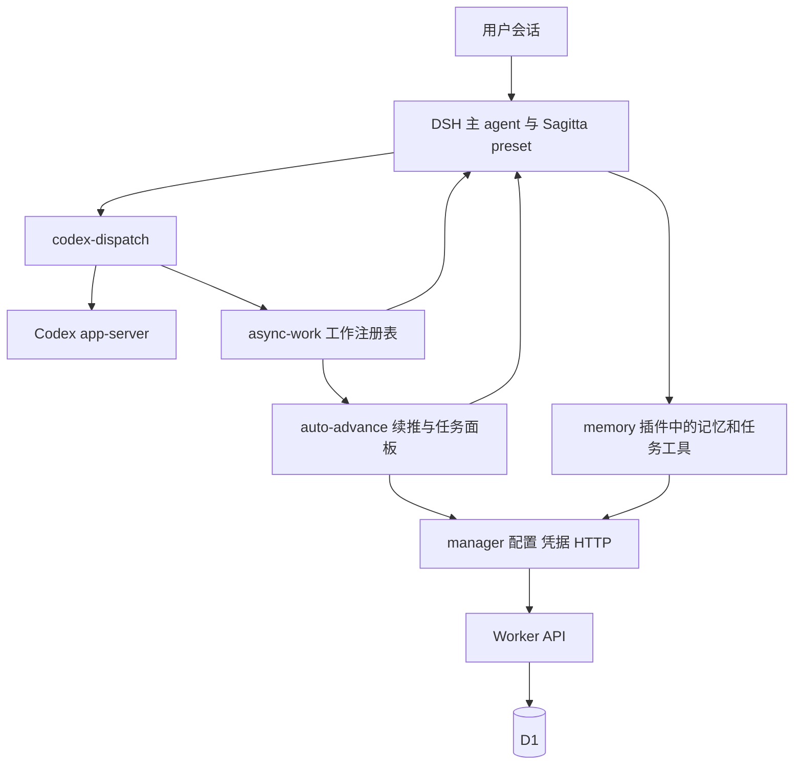

# Sagitta 代码现状与服务器迁移评估

本次基于 GitHub `main` 的 `cf172fa` 分析，结合 2026 年 10 月 14 日的本地测试与 `void-island-site` 服务器检查。结论是：当前系统已有可复用的基础设施与数据契约，同时存在任务归属、执行生命周期、召回和重复查询的问题。服务器具备运行一个轻量数据 API 的初步条件；先迁数据服务，再讨论任务与记忆的业务机制，可以把变更范围控制住。

## 版本与验证范围

本地已同步至 GitHub 最新提交 `cf172fa`，提交时间为 2026 年 9 月 27 日。同步前的本地版本是 8 月的 Python 规划器；远程当前版本是 DeepSeek Harness（DSH）的 JavaScript 插件系统，两者架构差异很大。开场提供的 Python 规划器版 AGENTS.md 描述属于另一版本，当前代码分析以实际 DSH 实现为对象。

本地恢复点保存在分支 `codex/local-before-github-sync-20261014` 和带日期说明的 Git stash 中；残留 Python 缓存与安装元数据移到 `/Users/cyan/Documents/SagittaAgent-local-backup-20261014/`。本次业务代码保持 GitHub 版本。

验证结果：

- 43 个 JavaScript 与测试文件通过 `node --check`。
- 安装声明版本的 DSH 测试依赖后，14 个离线测试入口全部通过，其中 Worker 有 14 项测试，记忆主 smoke 有 63 项检查。
- Worker 和记忆主 smoke 使用真实 `worker.js` 与本地 SQLite；其他部分包含 HTTP、DSH 上下文和执行器替身。
- 真实 Codex app-server 集成入口在此 Mac 环境中因默认查找 Windows npm 路径失败。它还写死 Windows工作目录；其线上协议与实际模型执行需要在对应运行环境另行验证。
- Cloudflare 生产数据库内容、配额指标和 DSH 真机安装状态尚未取得。因此配额原因是代码支持的判断，具体触顶指标需由线上数据确认。

## 当前运行结构



按 `lib/*.js` 计算，五个插件加 Worker 共 10,503 行，含注释和空行，排除测试、声明文件、preset、SQL 与安装脚本。

| 模块 | 行数 | 当前实际职责 | 判断 |
| --- | ---: | --- | --- |
| manager | 744 | GUI 配置、凭据解析、HTTP、代理隧道、Worker 上传 | 统一通道已经完成；运行请求仍耦合部署凭据 |
| memory | 2,564 | 记忆工具、任务工具、认领门禁、项目召回 | 记忆与任务职责混合，是后续拆分的主要位置 |
| auto-advance | 3,367 | 自主续推、事件监听、任务快照、任务面板、typed RPC | 同时承担编排、读取与展示，重复查询和契约投影较多 |
| codex-dispatch | 611 | app-server 会话与工作适配 | 第二轮执行和注册表终态之间存在缺口 |
| async-work | 616 | 工作登记、超时、结算、最近历史、通知 | 边界较清楚；生命周期限于当前进程 |
| Worker | 2,601 | 认证、路由、记忆与任务业务、SQL、自举迁移 | 可迁到 SQLite；需整理迁移和认证边界 |

这是一套有任务状态与后台续推的协调系统。当前任务表保存了任务，async-work 保存了进程内工作；崩溃后恢复执行器、重建工作生命周期、独立验收和经验演进仍需要进一步实现。

## 基础设施重构完成程度

用户记得的基础设施改造已有明确落点：manager 统一 HTTP 通道和凭据，memory 与 auto-advance 调用 manager，updater 已删除，codex-dispatch 已换 app-server，preset 随 manager 分发并由安装器物化到用户目录。

9 月 27 日的记忆清理决策与修改初稿主要仍是待施工内容。实际代码仍保留四流、`ripple` 枚举、旧记忆字段、delegations 接口，以及包含 digest/corroborate 的批量 consolidate。任务侧也保留 priority、stream、ripple-stop 和旧客户端兼容分支。

文档与实现已经出现分叉。例如规格写包内 preset 直接发现，后续安装器改为物化用户目录；进展报告顶部写已完成，底部仍列旧待办；README 写五个任务工具，实际 memory 注册 17 个工具。应以代码和测试重新建立一份当前机制说明，把旧文档明确标为历史决策。

### DSH 接入、预设与更新的补充核查

2026 年 10 月 14 日对照官方 GitHub `571902028a75c64c1d767f4ae5fd099485f0ddf0`、npm 发布信息及 `0.1.1-rc.2` 的官方发布包。以下判断针对仓库代码；Windows 实际运行的 DSH 版本与用户 profile 尚待核实。

**接入骨架有官方依据。** Cordis 的插件入口、依赖注入、`dsh.bundle.patch`、`dsh.profile.bundles`、`dsh.client`、settings/credentials 服务和 `ctx.systemPrompt.section()` 都沿用官方扩展机制。manager、auto-advance、async-work 位于 host 层，memory、codex-dispatch 位于 preset 层，这个分层有合理依据。官方装饰插件模板同样使用 `window.__ModuleLoader__.load()`，这个包装格式本身属于官方做法。[官方插件模板](https://github.com/deepseek-ai/deepseek-harness/blob/571902028a75c64c1d767f4ae5fd099485f0ddf0/packages/preset/agent-preset/skills/cordis-plugin-development/templates/decoration/client.js)

**旧版目录复制方案有依据，但版本维护已经落后。** 官方 `dsh@0.1.1-rc.2` 的 `profile-boot` 确实覆盖 `agent-presets.roots`；该版官方 preset 包也明确支持 `<DSH_HOME>/.agent-presets`。因此安装脚本的说明与那个版本一致。官方 9 月 18 日的已实施架构决策改用 `dsh-agent-preset-registry` 和 `dsh-agent-preset`，在 Cordis 配置中声明预设，移除独立目录预设机制；当前 npm DSH 发布版 `0.2.0-rc.2` 已依赖新 preset 包。Sagitta 仍 patch 旧 `agent-presets`，同时 DSH 安装器浅克隆上游默认分支，缺少一个确定的兼容目标。当前上游 persona 使用 `prefix`/`suffix`，Sagitta 使用旧 `text` 并引用 `{{cwd}}`，也需随版本迁移核对。[官方预设迁移决策](https://github.com/deepseek-ai/deepseek-harness/blob/571902028a75c64c1d767f4ae5fd099485f0ddf0/.agents/notes/implemented/architecture/2026-09-18-declarative-agent-presets.md)、[官方 persona](https://github.com/deepseek-ai/deepseek-harness/blob/571902028a75c64c1d767f4ae5fd099485f0ddf0/packages/preset/persona/README.md)

**自动更新链路缺失。** `install.ps1:17` 遇到已有源码目录就返回；清洁工作树只输出更新政策说明。`install-profile-deps.ps1` 使用 GitHub 子目录依赖和 lockfile，执行 `pnpm install`；向新提交升级须另外执行 `pnpm update`。随后还须重跑安装脚本复制 preset，新会话再加载。部署 Worker 则从 manager.repoPath 的源码目录读取，插件安装版本、源码目录和已复制 preset 可以处于不同提交。启动时按 Worker SHA 部署与拉取 GitHub 更新是不同操作。

版本演化补充：官方 `0.1.7-rc.1`（9 月 23 日）发布说明已经明确列出旧目录预设迁移、settings 改由 profile 插件配置保存、旧 settings.yaml 一次导入，以及 `agent/session-start` 改为异步串行 `agent/created`。Sagitta manager 的旧 settings 服务依赖和 auto-advance 的生命周期监听都须按目标版本审查。`0.2.0-rc.2` 的实际 persona 源码已要求 `prefix`；`{{cwd}}` 内置变量移除则列在 `0.2.1-alpha.1` 的升级指南中。当前源码、默认 npm 候选版和 alpha 渠道的变化应分别说明。[0.1.7 说明](https://github.com/deepseek-ai/deepseek-harness/releases/tag/dsh-v0.1.7-rc.1)、[0.2.0 persona 源码](https://github.com/deepseek-ai/deepseek-harness/blob/dsh-v0.2.0-rc.2/packages/preset/persona/src/index.ts)、[0.2.1 工作目录迁移](https://github.com/deepseek-ai/deepseek-harness/blob/master/docs/upgrade-guide/v0.2.1-alpha.1/working-directory/guide.zh.md)

**通信协议存在手工维护与实际漂移。** auto-advance 在 host Typert 文件、remote-client 文件、声明文件及浏览器 client.js 中重复定义协议；浏览器还手工提供 `{ _zod: {}, parse }` 对象，service.js 手工运行 Remote 装饰器 initializer。官方推荐从 TypeScript Remote 定义生成 host/client 契约。直接导入实际 host schema 的本地探针证明：`getTasks` 返回的 `pendingRequestsError` 经 schema.parse 后被剥除，而浏览器代码依赖它展示待处理需求读取失败。这是具体可复现的字段损失。[官方 Typert 生成流程](https://github.com/deepseek-ai/deepseek-harness/blob/571902028a75c64c1d767f4ae5fd099485f0ddf0/packages/typert/generator/README.md)

**全新安装路径存在静态可确认的缺口。** profile 不存在时，脚本创建空 bundles，再加入三个 Sagitta bundles，遗漏官方 `dsh-base` 与 `dsh-web-app`。官方 `app-boot@0.1.1-rc.2` 只在 package.json 不存在时初始化默认模板，已有用户 bundles 列表会原样保留。DSH 源码安装器只安装依赖并假定 `node_modules/.bin/dsh.ps1` 存在；当前官方源码说明要求构建并通过仓库脚本运行，Node 版本要求也高于 Sagitta 检查的 20.10。现有 verify-install 主要检查配置文本、路径与文件哈希，验收还须覆盖真实启动、新会话的工具/提示词及更新后的一致性。[官方运行说明](https://github.com/deepseek-ai/deepseek-harness/blob/571902028a75c64c1d767f4ae5fd099485f0ddf0/README.md)

建议先确定并固定一个 DSH 发布版本，建立源码、插件、preset 和数据服务的同版本安装更新流程，收敛 Remote 契约为单一生成源，并验证空目录安装及真实会话。已有 manager 网络取消、凭据职责和部署缓存问题也应在这个阶段处理。

## 已复现的问题与边界

### 任务归属与本地门禁

Worker 的认领和释放使用会话 owner，认领 SQL 是原子的，这部分值得保留。但普通 PATCH 的 owner 检查集中在 `status=in_progress`；`done/blocked` 的终态写入没有同等检查。

本地复现：A 认领任务后，B 带自己的 `X-Agent-Id` PATCH done，并提供一条格式合法的证据，得到 HTTP 200，任务进入 done。位置：`worker/worker.js:1832`、`:1887`、`:2027`。这意味着“认领保护工作归属”在状态更新路径中只覆盖了一部分操作。

本地 task-gate 保存 taskId、kind、status，省略租约到期信息；guard 直接读取缓存。给缓存放入一条过期认领后，执行型工具仍被允许。位置：`plugins/memory/lib/task-gate.js:72`、`:217`。云端刷新能清理缓存，但持续运行期间的时效性需要成为明确契约。

`installTaskGate` 在 guard 缺失或安装异常时退为 prompt+assert，异常被吞。硬门禁是否存在取决于 DSH 运行环境；应显式展示并验证当前模式。

### Codex 第二轮工作生命周期

第一次 `turn/completed` 会把 async-work 结算为 completed。`codex_append` 在已完成会话上调用 `turn/start` 后沿用旧 work，缺少新的 running 登记。

使用替身 app-server 和真实注册表复现：第二轮已经启动，返回状态仍是 completed，`listActive(owner)` 为 0。位置：`plugins/codex-dispatch/lib/index.js:237`、`:299`。这会影响并发槽位、超时追踪和自主推进的等待判断。会话可以跨多轮保留，但每轮执行的工作生命周期需要正确登记。

### 记忆召回存在两套路径

认领后的项目召回使用 `projects/${project}`，preset 的定向检索使用 `sagitta-agent/plugins` 这种“项目名/主题”路径。前者还把除 personal-projects 之外的任务都映射到 company-projects。

本地向 company-projects 写入 `domain=sagitta-agent/plugins` 后，直接检索该 domain 命中 1 条，认领路径 `projects/sagitta-agent` 命中 0 条。位置：`plugins/memory/lib/task-project-memory.js:18` 与 preset `agent.cordis.yml:79`。应先统一领域约定，再处理历史数据映射。

目前存在开场四流召回的提示词和认领后程序召回；每轮按问题检索、关键经验自动注入、后台经验提炼尚未形成可靠链路。“AI 是否记得调用工具”仍影响使用效果。

### HTTP 通道与部署耦合

`resolveCredentials` 每次解析 Access ID、Access Secret、upload token。普通 API 请求和只想取得 codexModel 的 `apiConfig` 也要求上传 token 存在。位置：`plugins/manager/lib/credentials.js:8`。运行请求、执行器设置和部署凭据应按消费者分别读取。

manager 的传输层使用固定 20 秒超时，忽略调用者传入的 AbortSignal。本地传入已取消的 signal 后，请求仍完成并返回 200。位置：`plugins/manager/lib/request.js:80`。auto-advance 的取消控制因此只在本地作废结果，底层请求仍继续。

部署缓存只比较源码 SHA。账户、脚本名、bindings 或目标 URL 改变而源码相同时，仍返回 up-to-date。位置：`plugins/manager/lib/deploy.js:51`。部署标识应包含目标和有效配置。

手写 CONNECT/TLS/HTTP chunked 解析属于可复用基础设施。Undici 已提供 ProxyAgent 与 CONNECT 示例，可评估以成熟库替换，同时保留 Sagitta 的错误和凭据语义。[Undici 官方示例](https://github.com/nodejs/undici/blob/main/docs/examples/proxy/fetch.mjs)

### VPS 迁移必须调整认证

Worker 见到任意非空 `CF-Access-Jwt-Assertion` 就放行。本地带伪造字符串且无 Bearer 的请求返回 200。位置：`worker/worker.js:287`。

线上是否可利用取决于 Access 网关和直达路径配置；这次复现证明的是应用层信任了该头。迁到 VPS 时，应由应用验证 Bearer，或完整验证 Access JWT。直接复制这段放行逻辑会把网关信任假设带到新的部署环境。

## Cloudflare 配额消耗

Cloudflare 当前免费额度分别为 Workers 每天 100,000 请求，D1 每天 500 万读取行和 100,000 写入行。D1 按实际扫描行计数，和返回条数不同。[Workers 限制](https://developers.cloudflare.com/workers/platform/limits/)、[D1 计费说明](https://developers.cloudflare.com/d1/platform/pricing/)

前端每 5 秒调用 getTasks，不受面板收起或自主推进关闭控制。getTasks 拉完整分页任务列表，再请求 need-human。代码位置：`plugins/auto-advance/lib/client.js:976`、`:1039`，`service.js:500`、`:1527`、`:1541`。

假设页面保持活跃 24 小时，网络成功且浏览器持续按间隔执行：

```text
刷新次数 = 86,400 / 5 = 17,280
每次请求 = ceil(普通任务数 / 200，最低 1 页) + 1 次 need-human
每天请求 = 17,280 × 每次请求
```

单页任务清单至少 34,560 请求/天；三个页面约 103,680 请求/天，尚未计入自主推进、回合结束刷新和模型工具调用。浏览器后台节流或网络失败会改变实际数字。

任务列表每页执行 COUNT 和完整查询，并为每条任务查询确认事件、最后进展、最后下一步和人工事项。SQLite 查询计划显示任务表扫描与多个临时排序；事件索引主要按 task_id，查每个任务最新事件仍需扫描其历史。位置：`worker/worker.js:1407`、`:1670`。

若有 150 条任务，按每轮两次扫描任务表粗估，单页面一天可达到 `150 × 2 × 17,280 = 5,184,000` 行，事件与人工事项读取另计。这是量级示例，实际 D1 rows_read 需线上指标核实。代码对 D1 读取额度形成压力的证据比“正常使用量很大”更具体。

schema 自举有 WeakMap 缓存。相同 DB 对象下，首次 `/task` 准备 19 条 SQL，其中 11 条 DDL、6 次 PRAGMA；后续相同对象准备 2 条 SQL。新 DB 对象又回到 19 条。它并非每次请求必然执行全部迁移，但开销依赖运行实例与绑定对象复用。迁移应移到部署或服务启动阶段。

优先处理：后端合并并发读取；展示快照有明确有效期；写成功后使快照失效；面板隐藏时降低刷新；推进决策使用必要的权威状态。租约到期和按 owner 投影需要纳入缓存设计，避免跨会话复用错误归属。单纯把查询间隔改长会缓解消耗，但仍保留重复读取的结构。

## void island 服务器适用性

10 月 14 日通过 SSH 对 `void-island-site` 进行只读检查：

| 项目 | 实测 |
| --- | --- |
| 系统 | Ubuntu 22.04.5，x86_64 |
| CPU | 1 vCPU，检查时 load average 0.00 / 0.02 / 0.00 |
| 内存 | 951 MiB 总量，约 492 MiB available |
| Swap | 约 2.4 GiB，约 146 MiB 已使用 |
| 根盘 | 23 GiB，剩余约 5.3 GiB，使用率 76% |
| 网页 | PM2 管理，端口 3000，RSS 约 102 MiB |
| 网页健康 | 本地 HTTP 200，约 7 ms；公网 HTTP 200，约 286 ms |
| 公网入口 | 两个 cloudflared 进程，分别服务网页和 webhook |
| 其他服务 | webhook、ReachFlow 代理等；Nginx 已安装但 inactive |
| Node | v20.19.5 |
| 日志占用 | `/var/log` 约 2.5 GiB，其中 journal 约 2.3 GiB |

初步判断：有余量试部署一个独立 Node API 和 SQLite。这个结论针对轻量数据服务；增加完整 DSH、并行 Codex 和构建任务需要另做资源评估。

短采样出现 I/O wait 尖峰，随后 3 秒磁盘统计空闲；I/O pressure 的一分钟平均 some/full 约 5.16%/4.79%。有间歇磁盘等待，当前网站仍健康。部署后应观察 API 延迟、RSS 和磁盘等待再确认长期承载能力。首次检查为只读；随后已按用户授权清除重复 webhook 配置、纯日志和冗余服务，关闭 ReachFlow 代理与 Codex app-server。最新可用内存约 570 MiB，根盘可用空间约 9.0 GiB。详见 [服务器清理记录](server-review-2026-10-14.md)。

### 最小迁移方案

```text
本地 DSH 五插件
    → manager HTTP
    → 已有 Tunnel 或独立 HTTPS 入口
    → VPS 上独立 Sagitta API 进程
    → SQLite 文件
```

这条链路让 VPS 直接保存数据。VPS 仅转发到原 Worker/D1 会继续消耗原配额；把 Tunnel 保留为网络入口，则数据调用无需经过 Worker/D1。Tunnel 的职责是连接公网入口与本机服务。[Cloudflare Tunnel 文档](https://developers.cloudflare.com/cloudflare-one/networks/connectors/cloudflare-tunnel/)

已有 Worker 只使用标准 Request/Response 和 D1 prepare/bind/first/all/run/batch；本地测试已经验证这些业务 SQL 可以运行于 SQLite。HTTP 接入可采用 Hono 的 Node adapter；SQLite 可评估 better-sqlite3。需要实现的是薄适配层、事务串行化、启动迁移与认证，而任务和记忆路由可以先沿用。[Hono Node 文档](https://hono.dev/docs/getting-started/nodejs)、[better-sqlite3](https://github.com/WiseLibs/better-sqlite3)

服务器 Node 20 和本机测试使用的 Node 24 有差异，生产运行时需固定版本。若选新 Node，可为 Sagitta 指定独立可执行文件路径，让现有网站继续使用当前运行时。部署沿用一个现成进程管理器或 systemd 即可；数据库持久化、备份恢复和实际请求并发需要纳入验收。

改造范围：

1. 给 Worker 业务提供 Node HTTP 与 SQLite 运行入口。
2. manager 的数据访问配置改为服务地址与运行凭据，拆开 Worker 上传配置。
3. 独立进程、独立数据目录与端口，验证现有网站健康。
4. 加日志上限、SQLite 备份与恢复检查。
5. 测试空库运行，再导入真实数据，最后切换客户端。

真实数据仍需取得。D1 支持导出 SQL；当前 HTTP 接口缺少完整任务事件与记忆审计历史的导出能力，因此仅逐页读公开业务接口会遗漏部分历史。完整迁移应使用 D1 导出，或增加受认证的完整导出入口；切换期间暂停写入并校验行数、关键记录与恢复路径。[D1 导出说明](https://developers.cloudflare.com/d1/best-practices/import-export-data/)

## 长期成长机制建议

用户提出的目标是“经历改变以后怎样做事”。现有记忆提供条目、信任分、替换链与检索，这些是基础；成长还需要程序负责触发学习与应用，并从实际结果检验经验。

建议先做一个小闭环：

```text
保留真实经历与结果
    → 在用户纠正、任务验收或阶段结束时提炼候选经验
    → 与已有经验比对，合并或记录冲突
    → 下一次相似问题自动提供相关经验与依据
    → 记录采用后的结果
    → 修订适用边界、替换错误经验或沉淀操作方法
```

**AI 忘记写**：由程序在明确事件后创建有界的提炼工作，输入实际会话、工具结果和用户反馈。提炼可返回“本次没有可保留经验”，避免把每轮对话都存成结论。重要的当场记忆仍可由主 agent 主动写入。

**AI 忘记读**：程序在会话恢复和任务切换时组装有限上下文：当前用户/项目理解、待处理承诺、少量相关经验及来源。主 agent 可以进一步搜索。自动注入先采用项目范围与关键字等可检查条件，再按实际命中质量增加语义检索。

**AI 怎样搜索**：从当前问题、项目和已知约束生成查询，先取得候选，再评估适用条件。中文全文检索需用真实问题验收，向量相似度可以帮助找候选，经验是否适用还要看条件、时效与证据。

**经历怎样变成经验**：一条经验至少用正文说明“当时情境、采取的行动、实际结果、下次适用条件和反例”。例如“迁移数据服务时先复现原 API 契约；某次先删字段造成客户端失配”比“要注意兼容性”更能指导行动。可先复用 content、condition、supersedes 和验证事件，并在正文引用来源；字段随实际消费者增加。

**经验怎样改变行为**：稳定经验可以形成一个可调用的检查步骤、排障方法或 skill；下一次执行应能指向具体采用的经验和效果。事实记录、对用户的理解和操作方法各自有不同使用方式，但可以共用简单存储。

现有信任轨道中“用户提出”和“未反对”会加分。用户偏好以其明确表述为权威；技术事实的成立仍需要证据。反复陈述同一未经检验的经验会提高分数，却可能强化错误。经验升级应看独立结果和反例，分数只表达已有信号。

评价成长应看相似任务的返工、重复错误、用户重复提醒和有效方法复用情况。记忆条数或高分条目数只能说明存储活动。

已有方案可借鉴：LangMem 提供提炼、合并、后台处理与行为规则优化；Letta 提供持续记忆和后台整理。它们解决了闭环中的部分基础问题，采用时仍需验证 Sagitta 的适用条件、回滚和实际效果。当前 JavaScript/DSH 架构可以先借鉴机制，整套引入会增加运行与集成成本。[LangMem](https://langchain-ai.github.io/langmem/concepts/conceptual_guide/)、[Letta 记忆与后台整理](https://docs.letta.com/configuration/memory)

## 主 agent 与多任务机制建议

用户指出的强制与灵活性冲突在当前代码中确实存在：写、编辑、PowerShell、派单等工具由任务认领门禁统一拦截，normal/temp 任务通过提示词区分用途。主 agent 的日常会话、临时调查、协调工作和长期交付还缺少清楚的行为边界。

硬约束宜放在承担持续责任的操作上：长时间执行必须登记；任务归属和并发受程序控制；工作结束写回事实；重启保留未完成责任；任务完成满足声明的验收条件。讨论、读取资料和短暂调查则允许主 agent直接进行。用户交付一个持续目标，或者短调查演变为多轮执行时，由工具包装层创建或绑定任务，减少模型反复填表。

临时行动也需要留痕，可以先记在会话活动中。持续执行和派单必须进入持久任务；把每个小动作都建成 temp 会增加任务噪声，因此应明确升级边界，并让包装层在越界时自动补齐登记。

为避免主 agent 只顾一个任务，程序应在会话恢复、用户消息、执行器完成、阻塞解除等时机提供精简的全局工作视图：哪些任务可推进，哪些正在等执行器，哪些等待用户，当前选择了什么。后台唤醒进行一次有界调度，选择可推进任务或给出等待理由。紧急用户对话可以改变当前焦点，其他任务的责任继续保留。

可以用现有 DSH 的 agent、jobs 和 async-work 能力组织“一个主 agent 与多个可追踪执行工作”。基础版本先实现全局视图、可靠事件与持久执行记录，后续根据实际使用再引入公平性或优先级策略。

当前 done 门禁验证的是证据结构：本地提供不存在的测试路径仍可完成任务。round-close/confirm 又是另一条终态通道，同一模型也能调用确认工具。如果目标包含独立验收，必须明确谁验证何种证据；普通 PATCH 与确认通道如何统一是产品决策，应在机制讨论中定下。

后续顺序按用户本轮要求：先准备和验证服务器数据服务，沿用业务 API；随后讨论主 agent 的职责、任务登记与验收，再落实经验提炼和自动应用。已复现的归属、工作生命周期和召回路径问题应作为每一步验收的具体案例。
